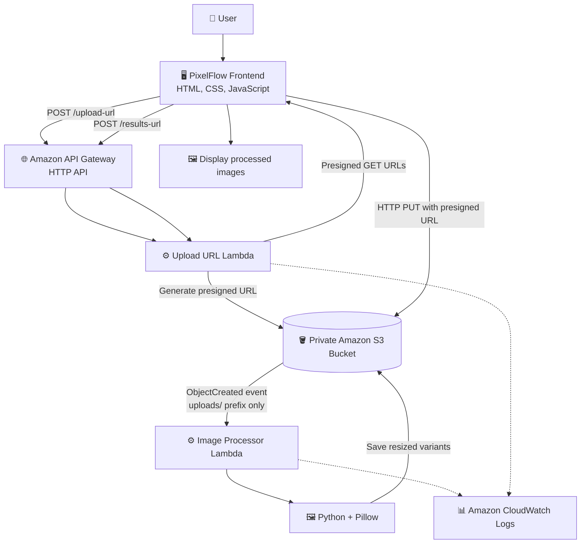

# 🏗️ PixelFlow — System Architecture

**Project:** Serverless Image Processing & Resizing System on AWS
**Cloud Provider:** Amazon Web Services (AWS)
**Region:** Asia Pacific (Mumbai) — `ap-south-1`
**Architecture Style:** Serverless, Event-Driven Architecture

---

## 📌 1. Architecture Overview

PixelFlow is a serverless image-processing application that allows users to upload images through a web interface and automatically generate multiple resized versions.

The system uses Amazon S3 for object storage, Amazon API Gateway for HTTP endpoints, and AWS Lambda for presigned URL generation and image processing.

An S3 event notification invokes the image processor when an original image is uploaded. The processor uses Python and Pillow to generate Thumbnail, Medium, and Large variants and stores the results in S3.

### 🎯 Architecture Goals

* ⚡ Automatically process images after upload.
* ☁️ Use managed AWS services without maintaining a continuously running application server.
* 🔒 Keep uploaded and processed images private.
* 📈 Support an event-driven workflow that can scale with demand.
* 🧩 Separate image uploads, processing, and result retrieval.
* 💰 Pay for serverless execution and storage according to usage.

## 🗺️ 2. High-Level Architecture Diagram



### 🔍 Diagram Explanation

1. The user selects an image in the frontend.
2. The frontend requests a presigned upload URL from API Gateway.
3. The URL-generation Lambda creates a temporary upload URL.
4. The browser uploads the image directly to S3.
5. S3 invokes the image processor Lambda through an object-created event.
6. The processor generates resized images with Pillow.
7. The generated images are stored under the `processed/` prefixes.
8. The frontend requests the processing results.
9. The results endpoint returns presigned URLs for available output images.
10. The frontend displays the results.

## 🧩 3. AWS Components

| Component                  | Responsibility                                                   |
| -------------------------- | ---------------------------------------------------------------- |
| 🖥️ Frontend               | Image selection, upload workflow, navigation, and result display |
| 🌐 Amazon API Gateway      | Exposes the upload and results HTTP endpoints                    |
| ⚙️ Upload URL Lambda       | Generates presigned upload URLs and presigned result URLs        |
| 🪣 Amazon S3               | Stores original images and resized variants                      |
| 🔔 S3 Event Notification   | Invokes processing for new objects under `uploads/`              |
| 🖼️ Image Processor Lambda | Resizes images using Python and Pillow                           |
| 📊 Amazon CloudWatch       | Stores Lambda execution logs                                     |
| 🔑 AWS IAM                 | Controls access to AWS resources                                 |

## 🔄 4. Detailed Processing Workflow

### Phase 1 — Image Upload

**Step 1: Select the image**

The user selects a JPEG or PNG file in PixelFlow. The frontend checks the file type and applies the configured 10 MB size limit.

**Step 2: Request an upload URL**

The frontend sends a `POST` request to:

```http
POST /upload-url
```

The request is routed through API Gateway to the URL-generation Lambda.

**Step 3: Generate the presigned URL**

The Lambda generates a presigned S3 upload URL for the intended object key.

**Step 4: Upload the file**

The browser uploads the image directly to S3 using HTTP `PUT`.

This avoids sending the image file through the URL-generation Lambda.

### Phase 2 — Image Processing

**Step 5: Trigger the processor**

S3 sends an object-created event when an image is uploaded under `uploads/`.

**Step 6: Invoke the image processor**

The event invokes the image processor Lambda.

**Step 7: Resize the image**

The processor uses Python and Pillow to generate the required image variants.

**Step 8: Store the outputs**

The processor saves the generated variants in the corresponding output prefixes in S3.

### Phase 3 — Retrieve Results

**Step 9: Request the results**

The frontend sends:

```http
POST /results-url
```

with the original image filename.

**Step 10: Check output availability**

The URL-generation Lambda checks the expected output objects and identifies available variants.

**Step 11: Generate result URLs**

The Lambda generates presigned GET URLs for available output images.

**Step 12: Display the results**

The frontend uses the returned URLs to display the processed images.

> Processing is asynchronous. The frontend may need to poll the results endpoint until the output objects become available or a timeout is reached.

## 🗂️ 5. Amazon S3 Storage Architecture

The bucket separates uploaded originals from processed outputs.

```text
🪣 serverless-image-processing-anuj-2026/
│
├── uploads/
│   ├── sample-photo.jpg
│   ├── example-image.png
│   └── original-image.jpg
│
└── processed/
    ├── thumbnail/
    │   ├── sample-photo.jpg
    │   └── original-image.jpg
    │
    ├── medium/
    │   ├── sample-photo.jpg
    │   └── original-image.jpg
    │
    └── large/
        ├── sample-photo.jpg
        └── original-image.jpg
```

*Illustrative layout only. Actual filenames and extensions depend on the processor’s naming logic.*

### 📐 Image Variants

| Output    | Target specification             |
| --------- | -------------------------------- |
| Thumbnail | 150 × 150 pixels target          |
| Medium    | Maximum dimension of 800 pixels  |
| Large     | Maximum dimension of 1600 pixels |

The processor’s actual resize behavior determines whether the image is cropped, padded, or scaled while preserving its aspect ratio.

### 🔔 Why Separate Prefixes?

The input prefix is:

```text
uploads/
```

The output prefixes are:

```text
processed/thumbnail/
processed/medium/
processed/large/
```

The S3 notification is configured to listen only to `uploads/`. This prevents generated images from triggering the same processor repeatedly.

## 🌐 6. API Architecture

The application uses an Amazon API Gateway HTTP API.

### API Routes

| Method | Route          | Purpose                                            |
| ------ | -------------- | -------------------------------------------------- |
| `POST` | `/upload-url`  | Requests a presigned S3 upload URL                 |
| `POST` | `/results-url` | Checks processed variants and requests result URLs |

### Base URL

```text
https://<api-id>.execute-api.ap-south-1.amazonaws.com/prod
```

Replace `<api-id>` with the API ID from your AWS account.

### Upload Request

Example request structure:

```json
{
  "fileName": "sample-photo.jpg",
  "contentType": "image/jpeg"
}
```

### Results Request

```json
{
  "fileName": "sample-photo.jpg"
}
```

The exact request and response fields must match the deployed Lambda implementation.

### 🌐 CORS Configuration

For local development, the frontend origin is:

```text
http://localhost:5500
```

Configure API Gateway and S3 CORS to permit only the origins, methods, and headers required by the application.

## 🔐 7. Security Architecture

Security is enforced through private object storage, IAM permissions, and temporary access URLs.

### 🪣 Amazon S3

* Keep Block Public Access enabled.
* Use private bucket access.
* Separate upload and processed-object prefixes.
* Enable appropriate server-side encryption.
* Avoid granting public read or write permissions.

### 🔑 AWS IAM

Use least-privilege permissions for each Lambda function.

The URL-generation Lambda should have only the S3 permissions needed to generate URLs and check or access expected objects. The processor should have the permissions needed to read input objects and write processed outputs.

### 🔗 Presigned URLs

Presigned URLs grant temporary access to specific S3 operations. They avoid embedding AWS credentials in browser-delivered JavaScript.

Use reasonable expiration times and avoid logging or publishing full presigned URLs.

### 🛡️ Input Validation

* Validate file size and supported types in the frontend.
* Independently validate image content in the processor.
* Handle malformed requests and invalid filenames.
* Consider authentication, API throttling, and abuse prevention before production deployment.

## 📊 8. Monitoring and Logging

Amazon CloudWatch Logs can be used to troubleshoot both Lambda functions.

Recommended monitoring checks include:

* ⚙️ Lambda invocation errors.
* ⏱️ Lambda execution duration and timeouts.
* 🧠 Lambda memory usage.
* 🔔 S3 event delivery and processor invocation.
* 🌐 API Gateway errors and latency.
* 🪣 Failed S3 operations and permission errors.

CloudWatch alarms and dashboards can be added to improve operational visibility.

## 📈 9. Scalability and Availability

PixelFlow uses managed services designed to support scalable workloads.

* **AWS Lambda:** Runs processing code in response to events and scales execution capacity according to demand and configured limits.
* **Amazon S3:** Provides durable object storage for original and processed images.
* **Amazon API Gateway:** Manages HTTP request routing to Lambda integrations.
* **Event-driven processing:** Separates uploading from processing, allowing the frontend to remain responsive while processing occurs asynchronously.

Actual throughput depends on service quotas, Lambda concurrency, image sizes, timeout settings, and the configuration of the deployed resources.

This architecture demonstrates scalable serverless design; it does not by itself guarantee a specific availability target or processing time.

## ⚙️ 10. Development Configuration

The current development environment uses:

| Setting                     | Value                                   |
| --------------------------- | --------------------------------------- |
| AWS Region                  | `ap-south-1`                            |
| S3 bucket                   | `serverless-image-processing-anuj-2026` |
| Image processor runtime     | Python 3.12                             |
| Processor memory            | 512 MB                                  |
| Processor timeout           | 30 seconds                              |
| Pillow layer                | `serverless-image-processing-pillow:2`  |
| Input prefix                | `uploads/`                              |
| Frontend development origin | `http://localhost:5500`                 |

These settings describe the current development environment and may need to be changed when deploying to another AWS account.

## 🧪 11. Architecture Validation Checklist

* [ ] Frontend successfully requests upload URLs.
* [ ] The original image is uploaded to the `uploads/` prefix.
* [ ] The S3 notification invokes the correct processor Lambda.
* [ ] The processor generates all expected output variants.
* [ ] The output files are stored under the correct prefixes.
* [ ] The results endpoint identifies available output files.
* [ ] Presigned GET URLs allow the browser to view outputs.
* [ ] Missing results and processing errors are handled correctly.
* [ ] S3 remains private.
* [ ] Lambda IAM policies follow least-privilege principles.
* [ ] CloudWatch logs are available for troubleshooting.

## ⚠️ 12. Known Limitations

* The frontend currently runs locally for development.
* Processing History may be stored only in browser memory.
* Storage may show only objects known to the current frontend session.
* The results endpoint checks expected variants for a filename; a full S3 inventory requires additional backend functionality.
* Presigned URLs expire and must be refreshed when needed.
* Authentication, persistent history, production monitoring alarms, and advanced abuse protection may require further implementation.

These capabilities should be considered complete only after implementation and testing.

## 🗺️ 13. Future Architecture Improvements

Potential enhancements include:

* 🗃️ Amazon DynamoDB for persistent processing history and job status.
* 📚 A secure, paginated S3 inventory API.
* 🔐 Authentication and authorization.
* 🌍 Amazon CloudFront and HTTPS hosting for the frontend.
* 🚦 API throttling and upload quotas.
* 🔁 GitHub Actions for continuous integration and deployment.
* 🏗️ AWS CloudFormation or Terraform for infrastructure as code.
* 📊 CloudWatch dashboards and alarms.
* 🧪 Automated tests for Lambda functions and API integration.
* 🔄 A dedicated processing-status workflow for more reliable status tracking.

## 📁 14. Related Documentation

```text
serverless-image-processing/
├── README.md
├── frontend/
│   ├── README.md
│   ├── index.html
│   └── app.js
└── docs/
    └── ARCHITECTURE.md
```

Update this layout if the repository uses different folders for Lambda source code or documentation.

## 👤 Author

**Vivek**

*PixelFlow — Serverless Image Processing & Resizing System on AWS.*
