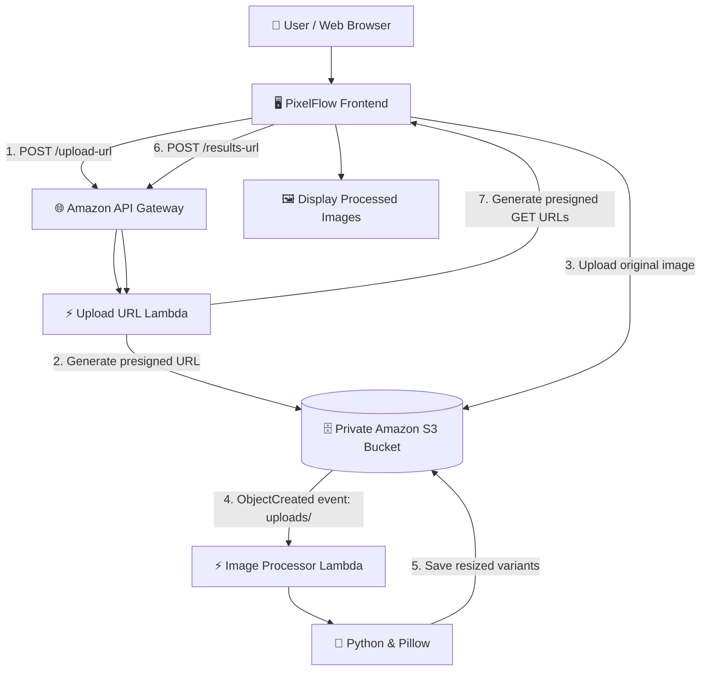

# 📸 PixelFlow — Serverless Image Processing & Resizing System on AWS

**PixelFlow** is a serverless image-processing application built using AWS services. It allows users to upload images through a web interface and automatically generates multiple resized versions using **AWS Lambda**, **Amazon S3**, **Python**, and **Pillow**.

The project demonstrates how to build an **event-driven, highly scalable** image-processing workflow without maintaining a continuously running application server.

---

## 📑 Table of Contents
- 🎯 [Project Overview](#-project-overview)
- 🎯 [Project Objectives](#-project-objectives)
- ✨ [Key Features](#-key-features)
- 🏗️ [System Architecture](#️-system-architecture)
- 🛠️ [AWS Services and Technologies](#️-aws-services-and-technologies)
- ⚙️ [How the Project Works](#️-how-the-project-works)
- 📏 [Image Processing Specifications](#-image-processing-specifications)
- 🗂️ [S3 Storage Layout](#️-s3-storage-layout)
- 🖥️ [Frontend Screens](#️-frontend-screens)
- 🌐 [API Endpoints](#-api-endpoints)
- ⚙️ [AWS Configuration](#️-aws-configuration)
- 💻 [Run the Project Locally](#-run-the-project-locally)
- 🔒 [Security](#-security)
- ✅ [Testing Checklist](#-testing-checklist)
- 🔍 [Troubleshooting](#-troubleshooting)
- ⚠️ [Current Limitations](#️-current-limitations)
- 🚀 [Future Enhancements](#-future-enhancements)
- 📁 [Project Structure](#-project-structure)
- 🎓 [Learning Outcomes](#-learning-outcomes)
- 👤 [Author](#-author)

---

## 🎯 Project Overview

Applications frequently need different image sizes for thumbnails, previews, and detailed views. Generating these versions manually increases processing time and application complexity. **PixelFlow** automates this process using AWS serverless services.

When a user uploads an image, it is stored in Amazon S3. An **S3 event triggers an AWS Lambda function** that processes the image and generates three resized versions: **Thumbnail**, **Medium**, and **Large**. The resulting images are stored in separate S3 prefixes and can be accessed through temporary presigned URLs.

This architecture demonstrates **event-driven automation**, **secure object storage**, and **serverless application integration**.

---

## 🎯 Project Objectives

- ⚡ **Automate image resizing** using AWS Lambda.
- 🗄️ **Store original and processed images** securely in Amazon S3.
- 🔔 **Trigger processing automatically** when a new image is uploaded.
- 🔌 **Use API Gateway** to connect the frontend with the serverless backend.
- 🔑 **Use presigned URLs** for secure, direct image uploads and downloads.
- 💻 **Build a simple, responsive frontend** for managing the image-processing workflow.
- 🛡️ **Apply IAM permissions and S3 configuration** to enforce least-privilege public access.

---

## ✨ Key Features

- 📤 **Image Upload:** Select an image or use drag-and-drop functionality.
- 🛑 **File Validation:** Validate supported file types (JPEG/PNG) and enforce a 10 MB limit.
- 🔒 **Secure Uploads:** Upload images directly to S3 using temporary presigned URLs.
- ⚡ **Automatic Processing:** Trigger image resizing automatically via S3 event notifications.
- 📐 **Multiple Output Sizes:** Generate Thumbnail, Medium, and Large versions.
- 🖼️ **Processed Image Previews:** Retrieve temporary URLs for viewing generated images.
- 🎨 **Image Studio:** Upload images and view processing results in real-time.
- 📜 **Processing History:** Track processing activity logged within the active session.
- 💾 **Storage View:** Browse processed images available in the current frontend session.
- ☁️ **Fully Serverless:** Utilize fully managed AWS services with zero server maintenance.

> ℹ️ **Note:** *Processing History and Storage are session-based frontend views. Persistent history and a complete live S3 inventory require additional backend endpoints.*

---

## 🏗️ System Architecture



### Architecture Components
1. 🖥️ **Frontend:** Web application interface for image upload and displaying results.
2. 🌐 **Amazon API Gateway:** Exposes HTTP API endpoints used by the frontend.
3. ⚡ **Upload URL Lambda:** Generates presigned URLs for uploading images and retrieving results.
4. 🗄️ **Amazon S3:** Central object store for original uploads and resized outputs.
5. 🔔 **S3 Event Notification:** Automatically triggers the processor upon file creation in `uploads/`.
6. ⚡ **Image Processor Lambda:** Resizes images asynchronously using Python and Pillow.
7. 📊 **Amazon CloudWatch:** Collects logs and metrics for execution tracking and debugging.
8. 🔐 **AWS IAM:** Controls access policies across all cloud components.

---

## 🛠️ AWS Services and Technologies

| Icon | Service / Tech | Purpose |
| :---: | :--- | :--- |
| 🗄️ | **Amazon S3** | Stores original and processed images |
| ⚡ | **AWS Lambda** | Handles image processing and presigned URL generation |
| 🌐 | **Amazon API Gateway** | Provides HTTP API endpoints |
| 🔔 | **S3 Event Notifications** | Automatically triggers image processing |
| 🔐 | **AWS IAM** | Manages permissions for AWS resources |
| 📊 | **Amazon CloudWatch** | Stores execution logs and supports troubleshooting |
| 🐍 | **Python 3.12** | Runtime for the Lambda functions |
| 🖼️ | **Pillow** | Image manipulation and resizing library |
| 🌐 | **HTML5 / CSS3 / JS** | Responsive frontend structure, styling, and logic |
| 💻 | **Python HTTP Server** | Serves the frontend during local development |
| 🐙 | **Git / GitHub** | Source control and project hosting |

---

## ⚙️ How the Project Works

### 📌 Step 1: Select an image
The user opens PixelFlow in a browser and selects a supported JPEG or PNG image. The frontend validates the file type and checks that the file does not exceed the configured 10 MB limit.

### 📌 Step 2: Request a presigned upload URL
The frontend sends a `POST` request to the `/upload-url` endpoint. The URL-generation Lambda creates a presigned S3 upload URL, allowing the browser to upload the image without embedding AWS credentials in frontend code.

### 📌 Step 3: Upload the original image
The browser uploads the image directly to the private S3 bucket using an HTTP `PUT` request. Original images are stored under the `uploads/` prefix.

### 📌 Step 4: Trigger the image processor
When a new image is created under `uploads/`, an S3 event notification invokes the image processor Lambda. The processor downloads the original image and uses Pillow to generate the resized versions.

### 📌 Step 5: Store the processed images
The generated images are uploaded to the appropriate S3 prefixes:
- 📁 `processed/thumbnail/`
- 📁 `processed/medium/`
- 📁 `processed/large/`

The event trigger listens only to the input prefix to prevent generated output files from repeatedly triggering the processor.

### 📌 Step 6: Retrieve processing results
The frontend sends a `POST` request to `/results-url` with the image filename. The URL-generation Lambda checks for the expected output objects and generates presigned GET URLs for available variants.

### 📌 Step 7: Display the results
The frontend uses the returned URLs to display the processed images in Image Studio. Users can navigate between Image Studio, Processing History, and Storage.

---

## 📏 Image Processing Specifications

| Variant | Target Dimensions | Description / Rule |
| :--- | :--- | :--- |
| 🖼️ **Thumbnail** | `150 × 150` pixels | Fixed dimension thumbnail output |
| 🖼️ **Medium** | Maximum dimension of `800` pixels | Scales down maintaining aspect ratio |
| 🖼️ **Large** | Maximum dimension of `1600` pixels | High-definition scaled preview |

---

## 🗂️ S3 Storage Layout

```text
serverless-image-processing-anuj-2026/
│
├── 📁 uploads/
│   ├── 📄 sample-photo.jpg
│   └── 📄 example-image.png
│
└── 📁 processed/
    ├── 📁 thumbnail/
    │   └── 📄 processed-image.jpg
    ├── 📁 medium/
    │   └── 📄 processed-image.jpg
    └── 📁 large/
        └── 📄 processed-image.jpg
```

> 🔒 **Security Notice:** The bucket is configured for private access with S3 Block Public Access enabled. Presigned URLs provide temporary access to authorized upload and download operations.

---

## 🖥️ Frontend Screens

1. 🎨 **Image Studio:** The primary screen for the image-processing workflow. Features drag-and-drop uploads, file detail previews, direct S3 uploads, and generated output previews.
2. 📜 **Processing History:** Provides a view of image-processing activity tracked by the active frontend browser session.
3. 💾 **Storage:** Visualizes processed image objects known to the active frontend session.

---

## 🌐 API Endpoints

**API Base URL:** `https://<api-id>.execute-api.ap-south-1.amazonaws.com/prod`

| Method | Endpoint | Purpose |
| :---: | :--- | :--- |
| `POST` | `/upload-url` | Generates a presigned upload URL |
| `POST` | `/results-url` | Checks for processed variants and returns presigned result URLs |

### 📥 Example: Request an upload URL
```json
{
  "fileName": "sample-photo.jpg",
  "contentType": "image/jpeg"
}
```

### 📤 Example: Processing Results Response
```json
{
  "thumbnail": {
    "available": true,
    "url": "https://s3.ap-south-1.amazonaws.com/bucket/processed/thumbnail/sample-photo.jpg?AWSAccessKeyId=...",
    "key": "processed/thumbnail/sample-photo.jpg"
  },
  "medium": {
    "available": true,
    "url": "https://s3.ap-south-1.amazonaws.com/bucket/processed/medium/sample-photo.jpg?AWSAccessKeyId=...",
    "key": "processed/medium/sample-photo.jpg"
  },
  "large": {
    "available": true,
    "url": "https://s3.ap-south-1.amazonaws.com/bucket/processed/large/sample-photo.jpg?AWSAccessKeyId=...",
    "key": "processed/large/sample-photo.jpg"
  }
}
```

---

## ⚙️ AWS Configuration

| Resource | Configuration Value |
| :--- | :--- |
| 📍 **AWS Region** | `ap-south-1` (Mumbai) |
| 🗄️ **S3 Bucket** | `serverless-image-processing-anuj-2026` |
| 🐍 **Image Processor Runtime** | Python 3.12 |
| ⚡ **Image Processor Memory** | `512 MB` |
| ⏱️ **Image Processor Timeout** | `30 seconds` |
| 📦 **Pillow Lambda Layer** | `serverless-image-processing-pillow:2` |
| 📥 **Input Prefix** | `uploads/` |
| 📤 **Thumbnail Prefix** | `processed/thumbnail/` |
| 📤 **Medium Prefix** | `processed/medium/` |
| 📤 **Large Prefix** | `processed/large/` |
| 🌐 **Local Frontend Origin** | `http://localhost:5500` |

---

## 💻 Run the Project Locally

### 📋 Prerequisites
- Python 3 installed.
- A modern web browser.
- Frontend files available locally.
- AWS backend resources deployed and configured.

### 🏃 Step 1: Open Command Prompt / Terminal
```bash
cd C:\Users\Anuj\Documents\Vivek\serverless-image-processing\frontend
```

### 🏃 Step 2: Start the local web server
```bash
python -m http.server 5500
```

### 🏃 Step 3: Open PixelFlow
Navigate to `http://localhost:5500` in your web browser.

---

## 🔒 Security

- 🛡️ **Private S3 Bucket:** Keep Block Public Access enabled.
- 🔐 **IAM Least Privilege:** Restrict each Lambda role to required S3 actions and prefixes.
- 🔑 **Presigned URLs:** Use temporary URLs instead of exposing AWS access keys to the browser.
- 🛑 **Input Validation:** Validate file size and type in the frontend and backend.
- 🌐 **CORS Protection:** Allow only the required origins, methods, and headers.
- 📊 **Logging Safety:** Use CloudWatch Logs to diagnose errors without logging sensitive data or full presigned URLs.

---

## ✅ Testing Checklist

- [x] 🌐 Frontend opens at `http://localhost:5500`.
- [x] 🧭 Image Studio, Processing History, and Storage navigation work.
- [x] 🖼️ A valid JPEG image uploads successfully.
- [x] 🖼️ A valid PNG image uploads successfully.
- [x] 🛑 Unsupported file types are rejected.
- [x] ⚖️ Files exceeding 10 MB are rejected.
- [x] 🗄️ Original image appears under `uploads/`.
- [x] ⚡ S3 event invokes the image processor Lambda.
- [x] 📐 Thumbnail, Medium, and Large outputs are generated.
- [x] 📤 Outputs appear under the correct S3 prefixes.
- [x] 🔗 `/results-url` returns URLs for available output variants.
- [x] 🖼️ All three processed images display correctly.
- [x] 🔒 No credentials or live presigned URLs are committed to GitHub.

---

## 🔍 Troubleshooting

| Issue | Check / Diagnostic Step | Solution |
| :--- | :--- | :--- |
| ❌ **Upload Fails** | Inspect browser Network tab and CloudWatch logs for `/upload-url`. | Ensure CORS settings match `http://localhost:5500` and check Lambda IAM role permissions. |
| ❌ **Processed Images Missing** | Confirm original image exists under `uploads/`. | Verify S3 event notification prefix mapping and confirm Pillow Layer compatibility. |
| ❌ **Results API Error** | Inspect results Lambda CloudWatch execution logs. | Check `BUCKET_NAME` environment variable and confirm S3 read permissions. |
| ❌ **Duplicate Extensions** | Compare target S3 keys with `/results-url` output. | Ensure string joining logic does not duplicate file extensions (e.g., `.png.png`). |
| ❌ **Slow Processing** | Review Lambda execution duration and memory logs. | Increase Lambda memory allocation to `512 MB` or adjust timeout limits. |

---

## ⚠️ Current Limitations

- 🌐 Local development server used for frontend hosting.
- 🧠 History & Storage list records persist only inside active browser memory sessions.
- ⏱️ Presigned URLs expire after a set time limit and require periodic re-fetching.
- 🔒 Production-grade auth (e.g., AWS Cognito) requires further implementation.

---

## 🚀 Future Enhancements

- 🗄️ Store processing history and status in **Amazon DynamoDB**.
- 🌐 Host frontend assets via **Amazon S3** and **Amazon CloudFront** over HTTPS.
- 🔐 Add authentication and authorization with **Amazon Cognito**.
- ⚡ Create automated CI/CD deployment pipelines using **GitHub Actions**.
- 🏗️ Define infrastructure as code using **AWS CloudFormation** or **Terraform**.

---

## 📁 Project Structure

```text
serverless-image-processing/
├── 📁 frontend/
│   ├── 📄 index.html
│   └── 📄 app.js
├── 📁 lambda/
│   ├── 📁 image_processor/
│   │   └── 📄 lambda_function.py
│   └── 📁 upload_url/
│       └── 📄 lambda_function.py
├── 📁 docs/
│   └── 📁 screenshots/
├── 📄 .gitignore
└── 📄 README.md
```

---

## 🎓 Learning Outcomes

This project provided hands-on practice with:
- ⚡ Building an **event-driven serverless architecture**.
- 🔗 Integrating **Amazon S3**, **AWS Lambda**, and **API Gateway**.
- 🔑 Using **Presigned URLs** for secure direct object uploads and downloads.
- 🖼️ Processing image media dynamically with **Python** and **Pillow**.
- 🔐 Managing granular **IAM permissions** and **CORS configurations**.
- 📊 Monitoring and debugging cloud execution via **Amazon CloudWatch**.

---

## 👤 Author

**Vivek**  
*PixelFlow was developed as a hands-on AWS project to explore serverless computing, event-driven automation, and automated image processing.*